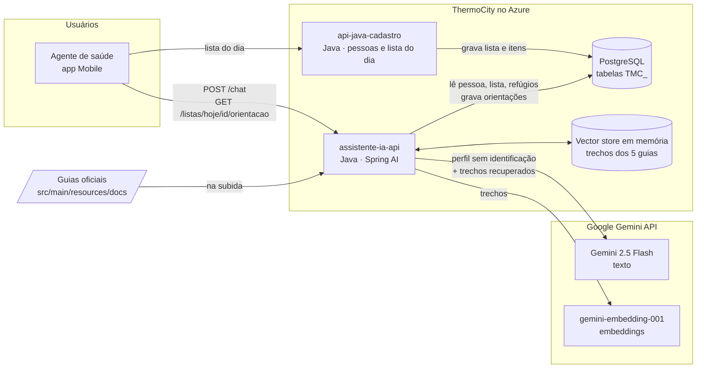
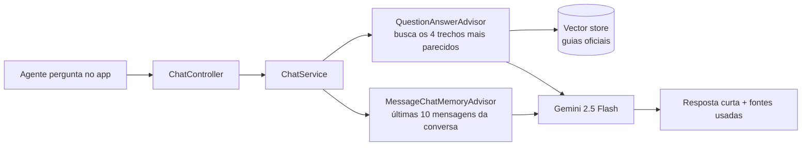
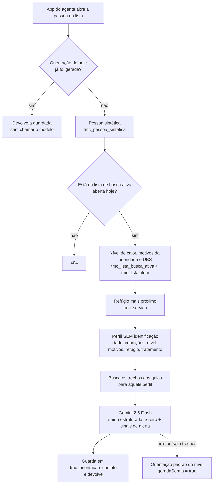

# assistente-ia-api — ThermoCity

## 👥 Integrantes

| Nome | RM |
| --- | --- |
| Arthur Graciani | RM561728 |
| Gustavo Oliveira | RM566358 |
| João Pedro Scarpin | RM565421 |
| Lucas Hideki | RM565355 |
| Wesley Andrade | RM563593 |

FIAP · Global Solution 2026/2 (CitizenTech) · Disruptive Architectures: IoT, IoB & Generative IA ·
Repositório: https://github.com/ThermoCity/assistente-ia-api

---

API de IA generativa do ThermoCity. Ajuda o agente de
saúde de uma UBS de Presidente Prudente-SP no contato por telefone com idosos durante uma onda de calor:

| Funcionalidade | Endpoint | PBI |
|---|---|---|
| **Tirar dúvidas** sobre calor e saúde do idoso, com resposta baseada em guias oficiais (RAG) | `POST /chat` | 55, 57, 58 |
| **Roteiro de contato personalizado** para cada pessoa da lista de busca ativa do dia | `GET /listas/hoje/{pessoaId}/orientacao` | 54 |

A IA **não decide quem é contatado** (isso é a lista priorizada da API de cadastro, com regra explicável) e
**não diagnostica**: ela organiza, em linguagem simples, o que os guias oficiais dizem para aquela situação.

---

## Arquitetura

Onde o assistente fica dentro do ThermoCity e com quem conversa:



- A **api-java-cadastro** decide quem entra na lista de busca ativa (regra explicável, sem IA) e grava a lista
  no PostgreSQL compartilhado.
- O **assistente-ia-api** só **lê** a lista, as pessoas e os refúgios, e grava apenas as orientações geradas
  (`tmc_orientacao_contato`).
- A Gemini API recebe o texto dos guias (para os embeddings) e um perfil **sem nome, telefone, endereço ou
  coordenadas** (para o roteiro). Detalhes do fluxo de cada endpoint abaixo.

---

## Como funciona

### 1. Base de conhecimento (RAG)

Na subida da aplicação, o `IngestaoService` lê os guias oficiais de `src/main/resources/docs`, divide cada um
em trechos (`TokenTextSplitter`), gera o embedding de cada trecho e guarda tudo num vector store em memória.
Cada trecho começa com a referência do guia (`[Fonte: título – instituição (data)]`), para o modelo saber de
onde veio cada informação e citá-la.

| Guia | Instituição | Data |
|---|---|---|
| [Ondas de calor (Saúde de A a Z)](https://www.gov.br/saude/pt-br/assuntos/saude-de-a-a-z/o/ondas-de-calor) | Ministério da Saúde | coletado em 2026-11-13 |
| [Insolação (Saúde de A a Z)](https://www.gov.br/saude/pt-br/assuntos/saude-de-a-a-z/i/insolacao) | Ministério da Saúde | coletado em 2026-11-13 |
| [Nota Técnica nº 18/2023-SVSA/MS – ondas de calor](https://www.gov.br/saude/pt-br/centrais-de-conteudo/publicacoes/notas-tecnicas/2023/nota-tecnica-no-18-2023-svsa-ms) | Ministério da Saúde / SVSA | 2023-11-24 |
| [Informe Técnico nº 03/2025 – Calor extremo e visitas domiciliares](https://www.rj.gov.br/saude/sites/default/files/arquivo_pagina_basica/CALOR-EXTREMO-E-VISITAS-DOMICILIARES_SES-RJ.pdf) | Secretaria de Estado de Saúde do Rio de Janeiro | 2025-12 |
| [Heat and Medications – Guidance for Clinicians](https://www.cdc.gov/heat-health/hcp/clinical-guidance/heat-and-medications-guidance-for-clinicians.html) | CDC (EUA) | 2025-09-18, coletado em 2026-11-13 |

Os textos foram convertidos para Markdown (`docs/*.md`) e a lista fica em `docs/fontes.csv`. O Protocolo de
Enfrentamento ao Calor Extremo da SMS-Rio (45 páginas) ficou de fora: o conteúdo útil para o contato por telefone
já está nos guias acima, e um documento longo diluía a busca.

### 2. Tirar dúvidas — `POST /chat`



```http
POST /chat
{ "conversationId": "agente-1", "message": "Quais sinais de alerta devo observar numa ligação?" }
```
Resposta: `{ "answer": "..." }`, terminando com as fontes usadas. O `conversationId` mantém o contexto da conversa
("E se ele estiver confuso?"). Perguntas fora do tema são recusadas; sem resposta nos guias, o assistente diz que
não encontrou e orienta consultar a equipe.

### 3. Roteiro de contato — `GET /listas/hoje/{pessoaId}/orientacao`



A resposta traz o roteiro da ligação (5 a 8 passos), os sinais de alerta com a conduta (ex.: "Pele muito quente,
confusão mental, desmaio ou convulsão: ligar 192 (SAMU) imediatamente."), o refúgio indicado, as fontes e o aviso
de que a orientação não é diagnóstico.

- **Uma geração por pessoa por dia:** a orientação fica guardada em `tmc_orientacao_contato`; abrir de novo não
  chama o modelo (mais rápido e sem custo).
- **Sem depender da IA:** se o modelo falhar, a API devolve uma orientação padrão do nível de calor
  (`OrientacaoPadrao`, escrita a partir dos mesmos guias), marcada com `geradaSemIa: true`. Ela não é guardada,
  para a próxima abertura tentar a IA de novo.
- **Integração com a API de cadastro:** a lista de busca ativa é gerada pela `api-java-cadastro` (Java). Este
  serviço só **lê** essas tabelas no mesmo PostgreSQL; nada é gravado nelas.

---

## Modelos e tecnologias

| Item | Escolha | Por quê |
|---|---|---|
| Linguagem e framework | Java 25, Spring Boot 4.1, Maven | mesma base das outras APIs Java do projeto |
| Integração com IA | Spring AI 2.0.1 (`ChatClient`, advisors, `.entity()`) | RAG, memória e saída estruturada sem código de baixo nível |
| Modelo de texto | **Gemini 2.5 Flash** (Google), pela API compatível com OpenAI | rápido e barato para respostas curtas; bom em português |
| Modelo de embeddings | **gemini-embedding-001** (Google GenAI) | o endpoint compatível com OpenAI devolve os embeddings sem o campo `index`, e o cliente da OpenAI falha; por isso os embeddings usam o cliente nativo do Google |
| Vector store | `SimpleVectorStore` (em memória) | são só 5 guias: cabem na memória e são indexados de novo a cada subida, sem banco vetorial para manter |
| RAG no chat | `QuestionAnswerAdvisor` (4 trechos) | o próprio Spring AI busca os trechos e monta o contexto |
| RAG no roteiro | busca própria (`BuscaGuiasService`) | a pergunta ao vector store descreve a situação da pessoa (mora sozinha, crônica...) e não um texto livre |
| Saída estruturada | `.entity(RoteiroIa.class)` | o roteiro vem como JSON (passos e sinais), pronto para o app mostrar |
| Banco | PostgreSQL (o mesmo das outras APIs), `ddl-auto=validate` | lê pessoas, refúgios e a lista do dia; guarda as orientações |

---

## Cuidados com dados pessoais (LGPD)

- **Nada que identifique a pessoa vai para o modelo.** A entidade `Pessoa` desta API nem mapeia nome, telefone,
  contato de referência ou endereço. O modelo recebe só um perfil (`PerfilContato`): idade, se mora sozinha,
  mobilidade reduzida, condição crônica, nível de calor, motivos da prioridade, refúgio mais próximo, nome da UBS
  e o tratamento ("a senhora" / "o senhor"). As coordenadas são usadas só aqui dentro, para achar o refúgio.
- **A busca nos guias também não leva dados da pessoa**: a consulta descreve a situação ("idoso que mora sozinho,
  doença crônica e medicamentos...").
- **Dados fictícios.** As pessoas usadas no MVP são do cadastro sintético (`tmc_pessoa_sintetica`), geradas pela
  base territorial na proporção do Censo 2022. Nenhuma pessoa real.
- **Provedor externo.** O texto enviado ao Gemini sai do nosso ambiente e é tratado pelo Google conforme os termos
  da Gemini API; no uso gratuito, o Google pode usar o conteúdo para melhorar os produtos. Por isso a regra acima
  é rígida. Num uso real, o caminho é um plano pago com retenção de dados desligada, ou um modelo hospedado pela
  própria prefeitura.
- **Chat livre.** No `POST /chat` o agente digita o que quiser; a API não filtra dados pessoais escritos na
  pergunta. A orientação para o app é não digitar nomes, telefones ou endereços.
- **Logs.** O `SimpleLoggerAdvisor` registra pedidos e respostas do modelo para depuração. Como o perfil não tem
  identificação, os logs também não têm; em produção, o nível de log deve ser reduzido.
- **Segredos.** A chave do Gemini e as credenciais do banco vêm só de variáveis de ambiente
  (`GEMINI_API_KEY`, `DB_URL`, `DB_USERNAME`, `DB_PASSWORD`); no Azure, nas configurações do App Service.

---

## Limitações

- **Não é diagnóstico nem prescrição.** O prompt proíbe diagnosticar e mexer em medicamentos, e toda resposta
  traz o aviso. Mesmo assim, um modelo pode errar: a orientação apoia o agente, não substitui o enfermeiro ou o
  médico da equipe.
- **Só sabe o que está nos 5 guias.** Assunto fora deles é recusado ou respondido com "não encontrei nos guias".
  Os guias têm data; se o Ministério da Saúde atualizar as orientações, os arquivos precisam ser trocados.
- **Citação de fonte depende do modelo.** O modelo é instruído a citar o guia de cada passo, mas pode citar de
  forma incompleta. A lista `fontes` da resposta vem dos metadados dos trechos recuperados, não do texto do modelo.
- **Sem índice de calor previsto.** O nível do dia vem da lista de busca ativa (NC3 a NC5); o índice de calor
  em °C virá da API de clima (.NET) quando ela estiver integrada. Hoje `icPrevistoC` vem nulo.
- **Distância em linha reta** até o refúgio, não pelo caminho das ruas. Refúgios "potenciais" (OpenStreetMap)
  dependem de parceria e podem não estar abertos.
- **Memória do chat em memória.** As últimas 10 mensagens de cada conversa ficam na memória da aplicação: somem
  quando ela reinicia e não são compartilhadas entre instâncias.
- **Vector store em memória.** Os guias são indexados a cada subida (chamadas ao modelo de embeddings), e a
  aplicação demora alguns segundos a mais para ficar pronta.
- **Variação das respostas.** O mesmo pedido pode gerar textos diferentes; por isso o roteiro é guardado e
  reaproveitado no mesmo dia.

---

## Como rodar

Requisitos: **JDK 25**, PostgreSQL com as tabelas `TMC_` (repositório `thermocity-banco-de-dados-postgres`,
incluindo `tmc_orientacao_contato`) e uma chave da Gemini API.

As variáveis necessárias estão em [`.env.example`](.env.example) (só exemplos, sem credenciais). Defina-as no
terminal, na configuração de execução do IntelliJ ou, no Azure, nas configurações do App Service:

```powershell
$env:DB_URL="jdbc:postgresql://localhost:5432/base_territorial"
$env:DB_USERNAME="..."
$env:DB_PASSWORD="..."
$env:GEMINI_API_KEY="..."
.\mvnw.cmd spring-boot:run      # sobe em http://localhost:8081
```

Para o roteiro funcionar, precisa existir lista de busca ativa no dia: gere pela API de cadastro
(`POST /simulacoes/nivel-calor`, como gestor) e use um `pessoa.id` de `GET /listas/hoje`.
Exemplos de chamadas em `test.http`.

| Status | Quando |
|---|---|
| 200 | resposta do chat ou roteiro (gerado agora, já guardado, ou padrão sem IA) |
| 400 | pergunta vazia, com mais de 1.000 caracteres ou id inválido |
| 404 | pessoa inexistente ou fora da lista de busca ativa de hoje |
| 503 | o modelo não respondeu no chat |

---

## Avaliação

As respostas foram avaliadas com 18 casos (12 perfis de idoso × níveis de calor × refúgio e 6 perguntas ao chat)
e critérios de uso das fontes, ausência de diagnóstico, menção ao refúgio e tempo de resposta. Casos, critérios,
resultados e análise em [docs/avaliacao-ia.md](docs/avaliacao-ia.md).

As situações de falha (modelo fora do ar, pessoa inexistente ou fora da lista, pergunta longa demais) também
foram testadas: com o modelo fora do ar, o chat responde 503 e o roteiro cai na orientação padrão do nível
(`geradaSemIa: true`), sem parar o atendimento. Ver a seção "Situações de falha" do mesmo documento.

---

## Declaração de uso de IA

Além do Gemini, que faz parte da solução (descrito em "Modelos e tecnologias"), o grupo usou IA generativa
no desenvolvimento:

| Ferramenta | Para quê |
|---|---|
| Claude (Anthropic) | pesquisa e conferência das fontes oficiais, sugestões de código e de prompt, explicação de erros e revisão dos textos e da documentação |

Todo o código, os prompts e os textos foram revisados e testados pelo grupo, que entende e responde por eles.
